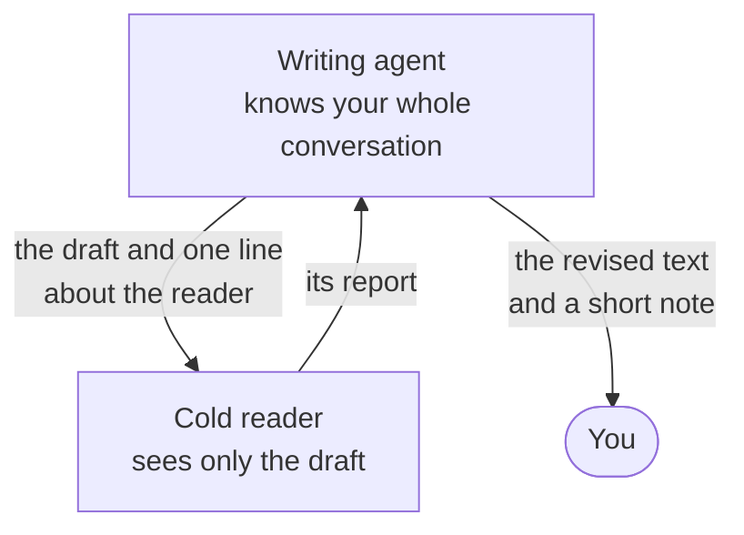

# Agent Copywriting

A plugin for Claude Code and Codex that makes your agent write for the person who will read the text.

An agent that writes an email, an article or a button label knows your whole conversation. The reader knows none of it. They have one page, and they stop reading when it stops helping them. This plugin gives the agent a method for that situation: it works out who the reader is, writes what they need in plain words, cuts the rest, and has the draft read by a second agent that has seen nothing but the draft.

It works in any language, and for articles, documentation, emails, chat messages, announcements, slides, landing pages and the text inside a product. Commit messages, code comments and the agent's replies to you are outside its scope.

## Example

The request was a LinkedIn post, written from a few lines of notes about an agency that stopped pitching for free. Both versions below were written from the same notes.

### The post without the plugin

It holds its result back, announces what is coming, and closes with a moral, a question to the audience and hashtags:

> Last year we stopped doing free pitches.
>
> I was nervous about it. […]
>
> Here are the numbers.
>
> […]
>
> Revenue was roughly flat year over year. So this isn't a story about growth. It's a story about getting the same result with a lot less wasted effort, and a lot less stress.
>
> […]
>
> Has anyone else tried this? I'd like to hear how it went for you.
>
> #agencylife #webdesign #smallbusiness

### The same post with the plugin

The first two sentences give the change and its result, and each paragraph after them adds facts:

> Last year my agency stopped doing free pitches. We offered a paid discovery workshop instead, and in 2025 we won more clients from fewer prospects.
>
> We're a six-person web agency. In 2024 we pitched for 11 projects and won 3. Those pitches took about 120 hours of unpaid work.
>
> In 2025 we offered prospects a discovery workshop at 8,000 kr. instead of a pitch. Seven took it, and five of them became clients. We did no unpaid pitch work that year.
>
> […]

## Install

### Claude Code

Inside Claude Code, submit:

```text
/plugin marketplace add ossianravn/agent-copywriting
```

Then submit:

```text
/plugin install agent-copywriting@agent-copywriting
```

The plugin is installed for your user account and is active in every session you start afterwards.

### Codex

In a terminal, run:

```sh
codex plugin marketplace add ossianravn/agent-copywriting
```

Then run:

```sh
codex plugin add agent-copywriting@agent-copywriting
```

Tested with Codex CLI 0.163.0 on 18 November 2026: the plugin installs with these two commands and works as described on this page.

## Use

Ask for the text and say who it is for:

```text
Write the email that tells our customers about automatic invoicing. They are small trades businesses.
```

The agent loads the plugin's instructions when you ask it to write, edit, shorten or review a text for a reader. You can also call them by name: `/agent-copywriting:copywriting` in Claude Code, `$copywriting` in Codex.

You get the text, ready to use, and a short note under it. This is part of the note from a test run, for an office-move announcement written from the organiser's notes:

> **The agent's note**
>
> - **What I left out:** the 12% cheaper lease, the deposit dispute and the name "Projekt Elbe". They don't change anything the team has to do. […]
> - **Two things to check:** I said the key cards are handed out at the reception in the new office. Your notes don't say which reception, so please confirm. […]

To check a text you already have, ask for a cold read, which is a read by a second agent that sees only the text, and name the reader:

```text
Give this announcement a cold read. The readers are our warehouse staff, who will see it on the noticeboard.
```

## How it works

### The agent writes in seven steps

The plugin contains one skill: a set of instructions that the agent loads when you ask it for copy. The skill takes the agent through seven steps.

1. **Know the reader.** The agent answers four questions: who reads this, where they meet it, what they already know, and what they must know or do afterwards. Then it states the point of the text in one sentence.
2. **Separate its own context from the reader's.** The agent treats everything from your conversation as invisible to the reader: working names, earlier drafts, decisions, the request itself. Each thing the text mentions is explained on the page or left out.
3. **Choose the content and its order.** The point goes first. After it comes what this reader needs in order to understand it, trust it and act on it. For articles, emails, slides, landing pages and product text, the agent first reads a reference file with the conventions of that format.
4. **Write plain statements.** The agent says what is the case, with the actual number or name, and uses only facts it has. Where the text cannot work without a missing fact, it writes `[NEED: …]` for you to fill in. Headings, tables and figures are written to make sense alone, for the reader who scrolls before reading.
5. **Cut.** A sentence stays only if the reader would miss it. The agent then checks the draft for ten habits that cost a reader effort, listed below.
6. **Get a cold read.** A second agent reads the draft as the reader would. The next section describes it.
7. **Hand over.** You get the text and the note described under Use.

### A second agent reads the draft with no context

A writer cannot forget what it knows, so it cannot tell whether its own draft stands alone. The skill therefore sends the draft to a cold reader. This is a new agent that receives two things: the draft, and one line saying who the reader is and where they meet the text.



The cold reader first scans the text as someone scrolling the page would, then reads it once, and reports:

- what it took the text to be after the opening
- the main point, in one sentence of its own
- each place where it stumbled, with the words quoted
- what it could have skipped
- what it still needed to know

The writing agent compares this report with the point it set in step 1. When the cold reader took away something else, the agent restructures the text. The writing agent also rewrites the places where the cold reader stumbled, cuts what the cold reader skipped, and passes the questions it cannot answer on to you.

In Claude Code, the cold reader is an agent that comes with the plugin. It starts without your project instructions (`CLAUDE.md`), its only tool is reading files, and its instructions limit it to the draft. Codex plugins cannot include agents, so in Codex the skill starts an ordinary subagent and gives it the same instructions. That subagent starts without your conversation, but it does receive your `AGENTS.md`.

The agent asks for a cold read when the text is longer than a short message, or when a misreading would be costly. To skip it for one request, say so. To get one for a short text, ask for it.

A cold read is one extra short agent session. In the test runs below, a request took 40 to 100 seconds and cost 0.16 to 0.38 USD with the plugin. Without it, the same requests took 20 to 50 seconds and cost 0.10 to 0.18 USD.

### The instructions describe what a sentence does, so they apply in any language

Many writing prompts list words and phrases to avoid. A list like that covers one language, and a model that is told to avoid one stock phrase tends to reach for the next. This skill contains no word list. It describes ten habits by their effect on the reader:

| Habit the agent checks for | What a text with this habit does |
| --- | --- |
| Performing | A sentence is written for effect: a maxim that closes a paragraph, a question the writer answers at once |
| Starting from what something is not | The text denies an idea the reader never had, then corrects it |
| Leaked context | The text leans on something only the writer has seen |
| Telling the reader how to react | The text rates its own content: "Interestingly", "a significant step" |
| Saying it more than once | A short text previews its content, delivers it and sums it up |
| Filling a pattern | Items come in threes, every paragraph has the same shape, every bullet opens with a bold label |
| Covering everything | Every consideration is listed and none is ranked |
| Abstract where a specific exists | "Experts say", "the implementation of the solution" |
| Miscalibrated certainty | Qualifiers pile up, or a claim is firmer than its source |
| Compressing past clarity | Connecting words are dropped, arrows and undefined abbreviations take their place |

For each habit the skill also gives the repair, and the case where the habit is the right choice. A contrast, for example, is right when the reader really holds the other view.

## Test results: 25 of 30 quality criteria met with the plugin, 18 without

Eight test cases come with the plugin. Each gives the agent a realistic request, and a model judges the reply against three to five criteria in plain language, such as "a customer who has seen nothing but this email can understand every reference in it". The table is from the latest full run of the first seven cases, on 18 November 2026 with Claude Code 2.1.325.

| Test case | Criteria met with the plugin | Criteria met without it |
| --- | --- | --- |
| Customer email, written from notes full of internal names | 5 of 5 | 4 of 5 |
| Interface text in Danish | 5 of 5 | 3 of 5 |
| Landing page for which no price or customer quote exists | 4 of 4 | 3 of 4 |
| Chat announcement in German | 4 of 5 | 3 of 5 |
| LinkedIn post | 2 of 3 | 1 of 3 |
| Edit of a colleague's newsletter piece | 2 of 3 | 1 of 3 |
| Slide deck for a decision | 3 of 5 | 3 of 5 |
| **All cases** | **25 of 30** | **18 of 30** |

Each case ran once, so the figures show a direction and will vary between runs. In earlier runs the editing case varied most.

The eighth case was added later. It asks for a results section with a table and checks that the table can be read without the text around it. With the plugin the table passed in 2 of 2 runs, and without it in 0 of 2.

To run the cases yourself, use the eval runner that is part of Claude Code, from a clone of this repository:

```sh
claude plugin eval . --runs 1 --judge-model sonnet --no-publish
```

This starts 16 agent sessions on your own account: each case once with the plugin and once without. `--judge-model` sets the model that judges the replies, and `--no-publish` keeps the report on your machine, in `evals/results/`. The run of seven cases above cost about 2.70 USD.

## What is in the repository

| Path in the repository | What it holds |
| --- | --- |
| `skills/copywriting/SKILL.md` | The seven steps |
| `skills/copywriting/references/` | The reference files for each format, the ten habits and the instructions for the cold reader |
| `agents/cold-reader.md` | The cold reader for Claude Code |
| `evals/` | The eight test cases and their criteria |

## Background: Strunk's rule for concise writing

The skill's rule for cutting a draft comes from William Strunk Jr., in *The Elements of Style*:

> Vigorous writing is concise. A sentence should contain no unnecessary words, a paragraph no unnecessary sentences, for the same reason that a drawing should have no unnecessary lines and a machine no unnecessary parts. This requires not that the writer make all sentences short or avoid all detail and treat subjects only in outline, but that every word tell.
